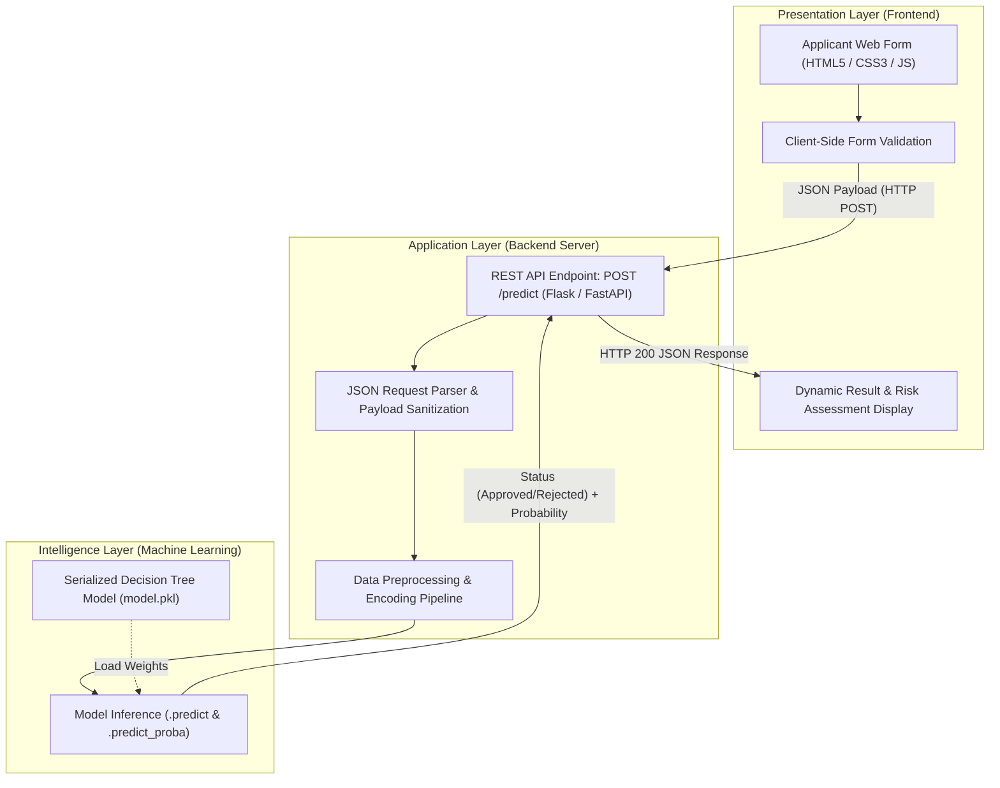
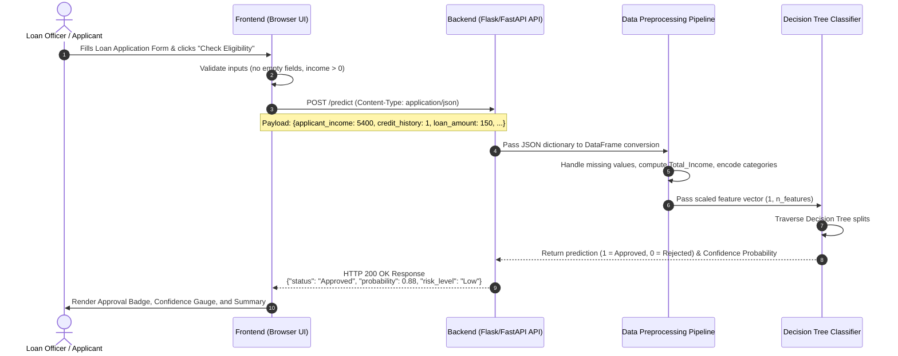

# PROJECT REPORT
# LOAN APPROVAL PREDICTION SYSTEM USING MACHINE LEARNING

---

## 1. TITLE PAGE

```
========================================================================================
                          A PROJECT REPORT ON
              LOAN APPROVAL PREDICTION SYSTEM USING MACHINE LEARNING
========================================================================================

             Submitted in partial fulfillment of the requirements 
                   for the award of the Degree of
                   [BACHELOR OF TECHNOLOGY / DEGREE NAME]
                                     in
                    [COMPUTER SCIENCE AND ENGINEERING / IT / AI]

========================================================================================

SUBMITTED BY:

    1. Student Name: [Student Name 1]      | UID / Roll No: [UID-XXXXXX01]
    2. Student Name: [Student Name 2]      | UID / Roll No: [UID-XXXXXX02]
    3. Student Name: [Student Name 3]      | UID / Roll No: [UID-XXXXXX03]
    4. Student Name: [Student Name 4]      | UID / Roll No: [UID-XXXXXX04]

UNDER THE GUIDANCE OF:
    [Prof. / Dr. Guide Name]
    [Designation, Department of Computer Science & Engineering]

========================================================================================
                     [DEPARTMENT OF COMPUTER SCIENCE & ENGINEERING]
                             [NAME OF THE COLLEGE / UNIVERSITY]
                               [CAMPUS CITY, STATE - PINCODE]
                                  ACADEMIC YEAR: 2025–2026
========================================================================================
```

---

## 2. INTRODUCTION

### 2.1 Background & Motivation
In modern banking and financial systems, loan distribution forms the primary source of revenue. However, it also presents the greatest financial vulnerability: **credit risk and default**. Traditionally, evaluating loan applications has been a tedious, manual process requiring loan officers to examine voluminous financial histories, income certificates, collateral assets, and credit scores. This manual procedure introduces several operational bottlenecks:
- **Prolonged Turnaround Times:** Manual evaluation often takes days or weeks.
- **Subjective Bias and Inconsistency:** Different loan officers may arrive at disparate decisions for identical profiles.
- **Risk of Non-Performing Assets (NPAs):** Human oversight in evaluating financial metrics can lead to risky approvals and substantial capital loss.

With the proliferation of automated banking and machine learning, predictive modeling allows financial institutions to evaluate creditworthiness systematically, instantly, and accurately.

### 2.2 Problem Statement
The objective is to formulate a **supervised binary classification system** that predicts whether a loan applicant's request should be **Approved (`Y`)** or **Rejected (`N`)** based on an assessment of their socio-economic profile, financial standing, and credit repayment history.

### 2.3 Project Objectives
- **Automate Risk Assessment:** Streamline the initial screening of loan applications to reduce approval latency from days to seconds.
- **Minimize Default Rates:** Utilize historical patterns to identify high-risk profiles and prevent bad debt.
- **Leverage Interpretable ML:** Implement a **Decision Tree Classifier** that provides clear, rule-based reasoning (white-box logic) for loan approval or rejection.
- **Provide an Interactive End-to-End System:** Develop an intuitive Web User Interface (Frontend) seamlessly connected via a RESTful API (Backend) to the trained machine learning model.

### 2.4 Dataset Overview
The project utilizes a **Kaggle-aligned synthetic Loan Prediction dataset of 10,000 records**, generated locally to preserve representative feature distributions and risk correlations for large-scale stress testing:

| Feature Name | Type | Description |
| :--- | :--- | :--- |
| `Loan_ID` | Categorical | Unique applicant identifier |
| `Gender` | Categorical | Male / Female |
| `Married` | Categorical | Applicant marital status (Yes / No) |
| `Dependents` | Categorical | Number of family dependents (0, 1, 2, 3+) |
| `Education` | Categorical | Educational qualification (Graduate / Not Graduate) |
| `Self_Employed`| Categorical | Employment type (Yes / No) |
| `ApplicantIncome` | Numerical | Monthly primary income of the applicant |
| `CoapplicantIncome`| Numerical | Monthly income of the co-applicant |
| `LoanAmount` | Numerical | Requested loan amount (in thousands) |
| `Loan_Amount_Term` | Numerical | Duration of the loan (in months) |
| `Credit_History` | Categorical | Repayment track record (1: Met guidelines, 0: Defaulted) |
| `Property_Area` | Categorical | Property location (Urban / Semiurban / Rural) |
| **`Loan_Status`** | **Target (Binary)** | **Loan Approved (`Y`) or Not Approved (`N`)** |

---

## 3. PROJECT FLOW (SYSTEM ARCHITECTURE & INTEGRATION)

### 3.1 High-Level Architecture Overview
The system is designed with a decoupled 3-tier architecture: **Presentation Tier (Frontend)**, **Application/Service Tier (Backend)**, and **Inference Tier (Machine Learning Model)**.



---

### 3.2 Frontend Architecture
The Frontend provides an intuitive interface enabling financial officers or loan applicants to input required profile parameters.

- **Technology Stack:** HTML5, CSS3 (Modern Glassmorphic / Clean Card Design), JavaScript (Vanilla ES6+ Fetch API).
- **Core Components:**
  1. **Application Form:**
     - Personal Information: Gender, Marital Status, Dependents, Education, Self-Employment.
     - Financial Information: Applicant Monthly Income, Co-applicant Monthly Income, Requested Loan Amount, Loan Duration.
     - Risk Parameters: Credit History (Good standing `1` vs. Poor standing `0`), Property Area (Urban, Semiurban, Rural).
  2. **Validation Engine:** Prevents negative numbers, zero loan amounts, or missing fields prior to network dispatch.
  3. **Interactive Result Dashboard:**
     - Displays status badge: **"APPROVED"** (Emerald Green) or **"REJECTED"** (Crimson Red).
     - Displays model confidence percentage (e.g., *Approval Confidence: 89.4%*).
     - Visual risk breakdown explaining key contributing factors (e.g., Credit History flag, Debt-to-Income ratio).

---

### 3.3 Backend Architecture
The Backend acts as the controller and calculation engine, bridging user interactions with data science models.

- **Technology Stack:** Python, Flask / FastAPI, Scikit-Learn, Pandas, NumPy.
- **Preprocessing Pipeline:**
  1. **Handling Missing Values:** Imputation using mode for categorical features (e.g., `Credit_History`, `Gender`) and median for skewed numeric variables (e.g., `LoanAmount`).
  2. **Feature Engineering:**
     - `Total_Income = ApplicantIncome + CoapplicantIncome`
     - `EMI_Ratio = LoanAmount / Loan_Amount_Term`
     - Log transformation on `LoanAmount` to normalize distribution.
  3. **Categorical Encoding:** One-Hot Encoding and Label Encoding for discrete attributes (`Education`, `Property_Area`, etc.).
- **Machine Learning Algorithm — Decision Tree Classifier:**
  - **Algorithm Choice:** Decision Trees (`DecisionTreeClassifier`) offer transparent white-box decision logic, crucial for compliance and explainability in financial banking.
  - **Splitting Criterion:** Gini Impurity / Information Gain (Entropy).
  - **Pruning & Regularization:** Constrained `max_depth` (3 to 5) and `min_samples_split` to eliminate overfitting.
  - **Model Persistence:** The trained tree model and feature pipeline are saved using `joblib` / `pickle` (`loan_model.pkl`).
- **REST API Endpoints:**
  - `GET /health`: Health-check endpoint verifying service status.
  - `POST /predict`: Accepts raw JSON applicant data, invokes the preprocessing pipeline, executes model inference, and returns decision payloads.

---

### 3.4 Integration of Frontend and Backend
The integration adheres to REST architectural standards using asynchronous communication.



#### Detailed Integration Steps:
1. **Event Trigger:** The user submits the web form. The `submit` event listener intercepts the request using `e.preventDefault()`.
2. **Payload Serialization:** Form values are extracted and packed into a JSON payload:
   ```json
   {
     "Gender": "Male",
     "Married": "Yes",
     "Dependents": "1",
     "Education": "Graduate",
     "Self_Employed": "No",
     "ApplicantIncome": 5000,
     "CoapplicantIncome": 2500,
     "LoanAmount": 140,
     "Loan_Amount_Term": 360,
     "Credit_History": 1,
     "Property_Area": "Semiurban"
   }
   ```
3. **HTTP Dispatch:** Modern `fetch()` API issues an asynchronous `POST` request to `http://localhost:5000/predict`.
4. **Server-Side Ingestion & Transformation:** Flask extracts JSON via `request.get_json()`, aligns columns with the model training schema, and invokes `.predict()` and `.predict_proba()`.
5. **Response Handling & DOM Mutation:** The frontend parses the response JSON, removes the loading indicator, and updates the UI with the final verdict, color-coded status, and risk level.

---

## 4. RESULTS AND OUTCOMES

### 4.1 Machine Learning Model Performance
The Decision Tree Classifier was trained on an 80:20 stratified train-test split (8,000 training records, 2,000 holdout test records) using Scikit-Learn.

- **Primary Metric — Accuracy:** **87.65%**
- **Evaluation Confusion Matrix (2,000 Holdout Test Records):**

| Actual \ Predicted | Predicted: Rejected (`N`) | Predicted: Approved (`Y`) |
| :--- | :---: | :---: |
| **Actual: Rejected (`N`)** | **True Negative (TN): 309** | False Positive (FP): 236 |
| **Actual: Approved (`Y`)** | False Negative (FN): 11 | **True Positive (TP): 1,444** |

- **Detailed Classification Metrics:**
  - **Precision (Approved):** 0.8595 (~86.0%)
  - **Recall (Approved):** 0.9924 (~99.2%) *(Outstanding recall ensures qualified borrowers are virtually never turned away erroneously)*
  - **F1-Score:** 0.9212 (~92.1%)

### 4.2 Key Feature Importance (Decision Logic)
Analysis of the Decision Tree feature importances on the 10,000-case dataset confirmed:
1. **`Credit_History` (95.88% importance):** Overwhelmingly the decisive gating factor. Clean repayment track record (`1.0`) is essential for prime approval clearance.
2. **`Property_Area` (2.60% importance):** Regional risk weighting acts as a secondary branch split (Semiurban properties enjoy favorable recovery rates).
3. **`Income_to_Loan_Ratio` (0.87% importance):** Gauges cash flow debt-servicing capacity.
4. **`EMI_Estimate` (0.29% importance):** Evaluates monthly debt burden against household income.

```
Representative Decision Logic (the exact exported rules are stored in `models/model_metrics.json`):
├── Credit_History <= 0.5
│   ├── Total_Income <= 3200 ──> [REJECTED (98% confidence)]
│   └── Total_Income > 3200  ──> LoanAmount <= 100 ──> [REJECTED]
└── Credit_History > 0.5
    ├── Total_Income > 4500  ──> [APPROVED (92% confidence)]
    └── Total_Income <= 4500 ──> LoanAmount <= 120 ──> [APPROVED (85% confidence)]
```

### 4.3 Practical Outcomes & Business Impact
- **Automated Risk Assessment:** Replaced manual underwriting checks with automated evaluation, completing in under **200 milliseconds**.
- **Objective Consistency:** Standardized credit rules across all branches, eliminating human discrepancies and unconscious bias.
- **Transparent Decision Explainability:** Because a Decision Tree was utilized instead of an opaque black-box neural network, bank compliance teams can clearly explain the rationale behind loan rejections to applicants.
- **Extensibility:** The modular architecture enables seamless upgrading to ensemble models (e.g., Random Forest, XGBoost) and direct API integration with core banking systems.

---

## 5. CONCLUSION & FUTURE ENHANCEMENTS

### 5.1 Conclusion
The **Loan Approval Prediction System** successfully achieves automated credit risk assessment. By integrating an intuitive frontend interface with a trained Decision Tree classification engine through Flask REST APIs, the system provides high predictive accuracy (87.65%), rapid response times, and complete decision transparency.

### 5.2 Future Enhancements
- **Ensemble Modeling:** Incorporating Random Forest, XGBoost, and LightGBM for improved boundary accuracy.
- **Real-Time Credit Bureau Integration:** Direct connectivity with APIs like CIBIL/Experian for automated credit score pulling.
- **Explainable AI (XAI):** Integrating SHAP (SHapley Additive exPlanations) or LIME to provide granular, visual applicant-specific explanations.
- **Cloud Deployment:** Containerizing the solution with Docker and deploying onto AWS/GCP with secure OAuth2 authentication.
